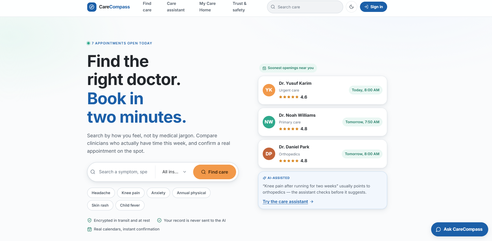

# CareCompass AI

CareCompass is a patient-first healthcare navigation and appointment platform. It helps people describe what they are experiencing, find an appropriate clinician, compare availability and access needs, book a visit, and manage follow-up care in one place.



> [!IMPORTANT]
> CareCompass provides navigation guidance, not medical diagnoses. If someone may be experiencing an emergency, they should contact their local emergency service immediately.

## Why it exists

Finding care is often harder than it should be. Patients may not know which specialty to choose, whether a clinician accepts their insurance, or how quickly they should be seen. CareCompass turns that uncertainty into a short path:

1. Describe the problem in everyday language.
2. Receive guidance about the type of care and urgency.
3. Compare matching clinicians and available appointments.
4. Book and manage care from a personal dashboard.

## AI assistant — the highlighted feature

CareCompass contains two complementary assistant experiences.

### Guided care assistant

The guided flow at `/assistant` asks the patient to describe their symptoms, answer a few focused questions, and rate severity. It then:

- checks for emergency warning signs before continuing;
- suggests how urgently the person should seek care;
- recommends a relevant medical specialty;
- shows matching clinicians with the soonest openings;
- provides limited self-care guidance while waiting; and
- clearly labels the result as guidance, never a diagnosis.

This flow is rule-based and runs in the browser. The symptom answers are not sent to the language model or saved to the patient's account.

### CareCompass chat

The floating chat assistant helps with clinician selection, booking, rescheduling, insurance questions, and product navigation. When OpenRouter is configured, responses stream from the server to the interface. If the model is unavailable or not configured, the app falls back to its built-in rule-based responses.

Important safety and privacy boundaries:

- Emergency red-flag checks run locally before any model request.
- Emergency routing never depends on the model or network availability.
- The assistant does not diagnose, prescribe medication, or decide clinical treatment.
- Only the words typed into chat and limited clinician context are sent to OpenRouter.
- Names, appointments, insurance information, and health records are not included in model requests.
- API keys remain on the server and are never exposed to the browser.
- Model input is limited to the most recent 12 messages and 1,200 characters per message.

The AI proxy is implemented in `server/chat.js` for local development and exposed through `api/chat.js` for serverless deployment.

## Main features

- Search by clinician name, specialty, symptom, or concern.
- Filter by insurance, language, distance, accessibility, visit mode, and availability.
- Review clinician profiles, focus areas, sample ratings, fees, and open times.
- Book, reschedule, or cancel appointments.
- Join and leave appointment waitlists.
- Download appointment details as an `.ics` calendar event.
- Manage visits, messages, preferences, and account data in **My Care Home**.
- Use speech-to-text for symptom entry in supported Chrome and Edge browsers.
- Navigate by keyboard and screen reader with light, dark, and text-size preferences.
- Protect account data with Supabase authentication and row-level security.

Clinicians, schedules, and reviews are currently sample data. Account, appointment, waitlist, and message data use the connected Supabase project.

## Technology

- React 19 and React Router
- TypeScript and JavaScript
- Vite 8
- Supabase authentication and PostgreSQL
- OpenRouter for optional streamed AI chat
- Radix UI Select
- GSAP animations
- Vitest

## Routes

| Route | Purpose |
| --- | --- |
| `/` | Home and care discovery |
| `/find` | Clinician search and filters |
| `/doctor/:slug` | Clinician profile and booking |
| `/assistant` | Guided symptom and specialty assistant |
| `/care` | Authenticated care dashboard |
| `/trust` | Privacy, safety, accessibility, and AI boundaries |
| `/auth` | Sign in and account creation |

## Local setup

### Requirements

- Node.js `20.19+` or `22.12+`
- npm
- A Supabase project
- An OpenRouter key if you want model-generated chat replies

### 1. Install dependencies

```bash
npm install
```

### 2. Configure environment variables

Copy `.env.example` to `.env.local`, then fill in the values:

```env
OPENROUTER_API_KEY=
OPENROUTER_MODEL=meta-llama/llama-3.3-70b-instruct:free
OPENROUTER_SITE_URL=http://localhost:5173

VITE_SUPABASE_URL=
VITE_SUPABASE_PUBLISHABLE_KEY=
```

`OPENROUTER_API_KEY` is optional. Without it, the assistant continues to work with local rule-based replies. The two Supabase variables are required for the app to start.

Never commit `.env.local`. It is already ignored by Git.

### 3. Prepare Supabase

Apply the SQL files in `supabase/migrations` in filename order. They create the database schema, row-level security policies, update triggers, slot exclusivity rules, and restricted function permissions.

You can apply them with the Supabase CLI if the project is linked:

```bash
supabase db push
```

Alternatively, run each migration through the Supabase SQL editor in filename order.

### 4. Start the app

```bash
npm run dev
```

Vite serves the frontend and mounts the local `/api/chat` proxy. Open the URL printed in the terminal, normally `http://localhost:5173`.

## Available commands

| Command | Purpose |
| --- | --- |
| `npm run dev` | Start the local Vite server and chat API middleware |
| `npm run build` | Type-check and build the production app |
| `npm run preview` | Preview the production build |
| `npm run typecheck` | Run TypeScript checks |
| `npm test` | Run the test suite once |
| `npm run test:watch` | Run tests in watch mode |
| `npm run check` | Run type-checking and tests |
| `npm run doctors:sql` | Generate SQL from the clinician seed data |

## Project structure

```text
api/                    Serverless chat endpoint
server/                 Shared OpenRouter chat handler
src/
  app/                  Application shell, routes, and providers
  domain/               Search, scheduling, triage, and data mapping rules
  features/             Auth, booking, care, directory, home, preferences, and triage
  lib/                  Supabase, motion, and environment helpers
  styles/               Global styles and design tokens
  ui/                   Shared interface components
supabase/migrations/    Database schema and security migrations
```

## Privacy and safety notes

- Supabase's browser publishable key is expected in the frontend; database row-level security determines which records a signed-in user can access.
- The OpenRouter secret is read only by the server-side chat handler.
- Chat requests are validated and length-limited before being forwarded.
- The guided symptom assistant is not a medical device and must not be presented as a replacement for professional care.
- Audit logging is scaffolded but not enabled for this pilot; it must be enabled before using real patient data.
- Review content and clinician availability are demonstrations, not live healthcare claims.


## Production checklist

Before using CareCompass with real patients:

- replace seed clinicians, schedules, and reviews with verified live data;
- enable and verify audit logging;
- complete independent accessibility and security reviews;
- provide staffed human-support and clinical escalation workflows;
- confirm regional emergency numbers and crisis resources;
- complete the legal, privacy, consent, and healthcare compliance review required for the deployment region; and
- monitor the configured AI model for availability, quality, and policy compliance.

## License

This repository does not currently declare an open-source license. All rights are reserved unless a license is added.
